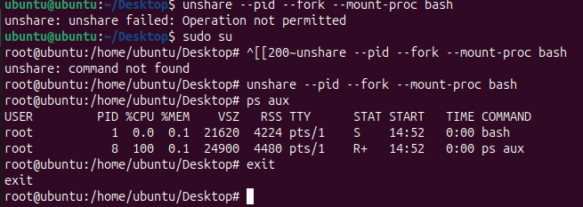
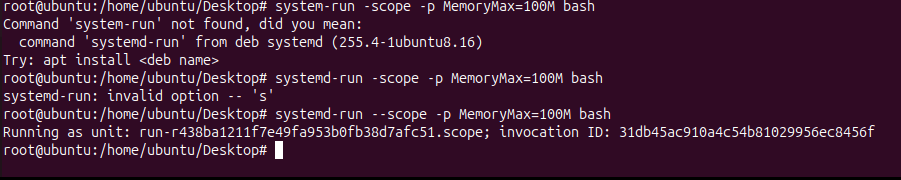
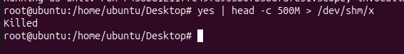

# Dziennik Laboratorium - Bezpieczeństwo w Systemach Operacyjnych

**Autor:** Mehmet Emin Aydın  
**Numer indeksu:** 74011  
**Tryb pracy:** Indywidualny (Projekt jednoosobowy)

---

## Temat 1: Piaskownica procesowa w Linuksie (przestrzenie nazw, cgroups)

### 1. Eksperyment 1 - Przestrzenie nazw (Namespaces)
- **Polecenie:** `unshare --pid --fork --mount-proc bash`
- **Obserwacja:** Uruchomiłem polecenie `ps aux`. Widziałem tylko 2 procesy (`bash` i `ps`). Inne procesy z systemu były ukryte.
- **Wnioski:** PID namespace izoluje procesy. Proces widzi tylko siebie i swoje procesy potomne.

---

### 2. Eksperyment 2 - Ograniczenie zasobów (cgroups)
- **Polecenie:** `systemd-run --scope -p MemoryMax=100M bash`
- **Obserwacja:** Najpierw ustawiłem limit 100 MB RAM dla nowej sesji bash. Następnie próbowałem użyć 500 MB RAM za pomocą polecenia `yes | head -c 500M > /dev/shm/x`. System zablokował proces i pokazał komunikat `Killed`.
- **Wnioski:** cgroups blokuje proces, kiedy zużywa za dużo pamięci RAM (więcej niż limit 100 MB).

---

## Podział ról i plan pracy na najbliższe 2 tygodnie

Projekt robię sam, więc wykonuję wszystkie zadania:
- **Konfiguracja środowiska:** Mehmet Emin Aydın (74011)
- **Implementacja rozwiązania:** Mehmet Emin Aydın (74011)
- **Dokumentacja:** Mehmet Emin Aydın (74011)
- **Prezentacja:** Mehmet Emin Aydın (74011)

### Plan działań (Najbliższe 2 tygodnie):
1. Tydzień 1: Nauka o seccomp i izolacji procesów w Linuksie.
2. Tydzień 2: Pisanie prostych skryptów do automatyzacji i aktualizacja plików na GitHubie.